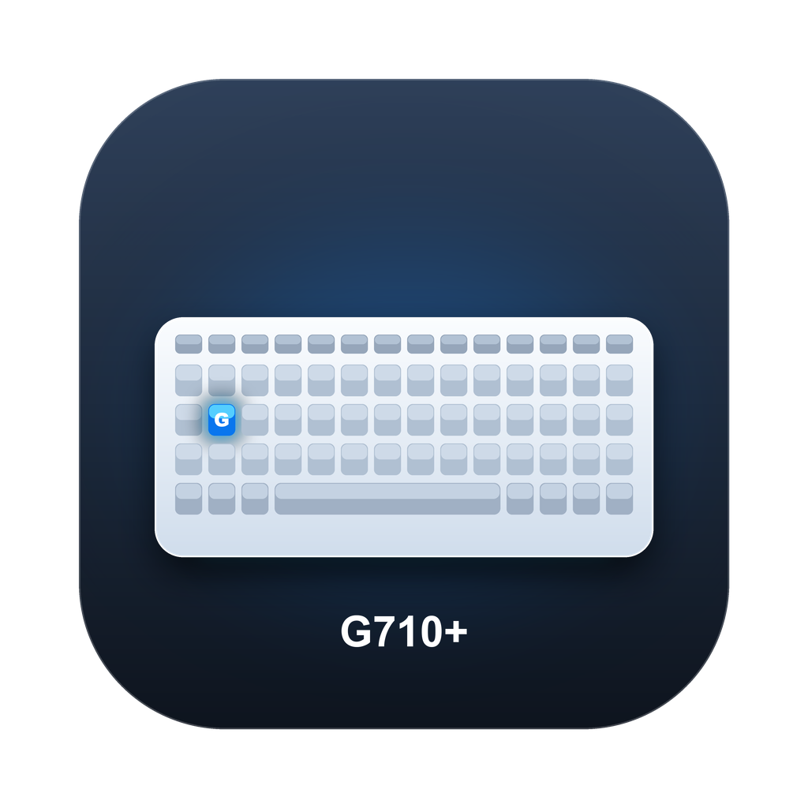

# G710Keys

**Make the G1–G6 keys of a Logitech G710+ keyboard actually usable on modern macOS.**



G710Keys is a tiny menu-bar app (pure Swift, no kext) that talks to the keyboard over USB HID,
stops the firmware from mirroring the G keys to the number row, and turns them into whatever
shortcuts or shell commands you want.

> Tested on macOS 26.7 (Apple Silicon) with a G710+ (`046D:C24D`). Should work on macOS 11+.

---

## Why does this exist?

Logitech never really supported the G710+ on macOS:

* Mac Logitech Gaming Software stopped at **8.98.306 (2018)**, 32-bit only (macOS 10.11–10.13).
  Logitech announced that **all LGS installers and documentation are removed as of 2026-10-31**.
* **G HUB** does not support the G710+.
* **Karabiner-Elements** cannot help on its own: the G keys are mirrored to the number row
  **by the keyboard firmware**, so Karabiner only sees ordinary `1`–`6` and cannot tell them
  apart — and grabbing the device with Karabiner breaks the G/M keys and the media keys too.
* The only historical macOS tool, [halo/g710plus](https://github.com/halo/g710plus), is archived
  (Swift 3 era) and its release binary is gone.

G710Keys is a modern reimplementation of the reversed protocol, plus a small GUI with
key recording.

## Features

* **G1–G6 → anything**: F13–F18 by default; remap to any key, ⌘/⌃/⌥/⇧ combo, or a shell command.
* **3 profiles (M1/M2/M3)** on the keyboard, with the M LEDs kept in sync.
* **Record button**: click Record next to a row, press the combo you want (e.g. ⌘C), done.
* **Long-press repeat** while a G key is held.
* **Menu bar app**, no Dock icon, no login item unless you add one.
* Config is a plain JSON file: `~/Library/Application Support/G710Keys/config.json`.

Note: the **media keys (volume, play/pause, next/prev) already work natively** on macOS —
G710Keys does not touch them. It only handles the G keys and the M profile keys.

## Build

Requires Xcode Command Line Tools (`xcode-select --install`) and Swift 5+.

```bash
git clone https://github.com/jk8978/logitech-g710-macos.git
cd G710Keys
./scripts/build.sh          # -> build/G710Keys.app (ad-hoc signed)
open build/G710Keys.app
```

Install into `/Applications` and launch:

```bash
./scripts/install.sh
```

## Permissions (required)

macOS protects HID devices and synthetic key events, so the app needs **two** permissions:

| Permission | Why |
|---|---|
| **Input Monitoring** | Reading the G keys' vendor HID reports |
| **Accessibility** | Posting the key combos you mapped |

Enable **G710Keys** in **System Settings → Privacy & Security → Input Monitoring / Accessibility**,
then quit and relaunch the app (there is a “Restart after granting” button in the window).

> ⚠️ The app is **ad-hoc signed**. Rebuilding or re-signing the binary changes its code signature,
> and macOS invalidates the two permissions above — you have to toggle them again in System
> Settings. Editing the config does not affect permissions.

## Usage

1. Connect the G710+.
2. Launch G710Keys — a keyboard icon appears in the menu bar and the status window opens.
3. Pick the profile to edit (M1/M2/M3 correspond to the M keys on the keyboard).
4. Click **Record** next to a G key and press the combo you want, or type it manually:

   | You want | Type |
   |---|---|
   | F13 | `f13` |
   | ⌘⇧4 (screenshot) | `cmd+shift+4` |
   | Open Safari | `shell:open -a Safari` |

5. Press the G key.

Supported key names: `a`–`z`, `0`–`9`, `f1`–`f20`, `numpad0`–`numpad9`,
`left`/`right`/`up`/`down`, `home`/`end`/`pageup`/`pagedown`,
`space`/`tab`/`return`/`escape`/`delete`/`forwarddelete`,
punctuation keys (`minus`, `equal`, `comma`, `period`, `slash`, `semicolon`, `quote`,
`backslash`, `leftbracket`, `rightbracket`, `grave`),
`numpadMultiply`/`numpadPlus`/`numpadMinus`/`numpadDivide`/`numpadDot`/`numpadEnter`.
Modifiers: `cmd`, `ctrl`, `opt`, `shift`.

## How it works

The G710+ exposes two HID interfaces (`046D:C24D`):

* a standard 6KRO boot keyboard (65-byte report descriptor), and
* a 149-byte descriptor with NKRO keyboard (report ID 1), Consumer page (report ID 2, the media
  keys) and a vendor page `0xFF00` (report IDs 3–9).

By default the firmware mirrors the G keys to number row `1`–`6`. The app sends a single
**Feature Report 9** (13 zero bytes) to disable that mirroring, then listens for vendor
**Report ID 3**, whose payload is:

```
byte 0: G1–G6 bitmask  (bit0 … bit5)
byte 1: M1/M2/M3/MR   (0x10/0x20/0x40/0x80)
byte 2: backlight / game-mode bits
```

Matching bindings are then posted with `CGEvent` to the HID event tap.

## Troubleshooting

* **G keys do nothing** — check both permissions are green in the app window; after granting,
  click “Restart after granting”. Check `~/Library/Logs/G710Keys.log`: pressing a G key should
  log `report rid=3 …`.
* **Media keys stopped working** — quit Karabiner-Elements, or uncheck the G710+ in its Devices tab.
* **G keys type 1–6 again after replug** — expected: the mirroring setting is runtime-only and
  resets when the keyboard is power-cycled. Launch the app again.
* **“App is damaged” / Gatekeeper after downloading a release build** — the build is ad-hoc signed,
  not notarized. Build from source, or run
  `xattr -dr com.apple.quarantine /Applications/G710Keys.app`.
* **MR key** — the G710+ has no onboard macro memory (LGS recorded macros on the host);
  G710Keys currently ignores MR.

## Alternatives

* [Karabiner-Elements](https://karabiner-elements.pqrs.org/) — great for normal keys, useless for
  G keys on this keyboard (see above).
* [g510-macos](https://github.com/paulloth1/g510-macos) and
  [G15Display](https://github.com/Tooker/G15Display) — other Logitech keyboards, but good references
  for the macOS HID + CGEvent approach.
* Linux: [logiops](https://github.com/PixlOne/logiops),
  [Wattos/logitech-g710-linux-driver](https://github.com/Wattos/logitech-g710-linux-driver).

## Acknowledgements

The reverse-engineered G710+ protocol was documented by
[K900/g710](https://github.com/K900/g710) and used by
[halo/g710plus](https://github.com/halo/g710plus). G710Keys would not exist without them.

## Disclaimer

Not affiliated with Logitech. “Logitech”, “G710+” and “G-Series” are trademarks of Logitech.
Use at your own risk.

## License

MIT — see [LICENSE](LICENSE).
